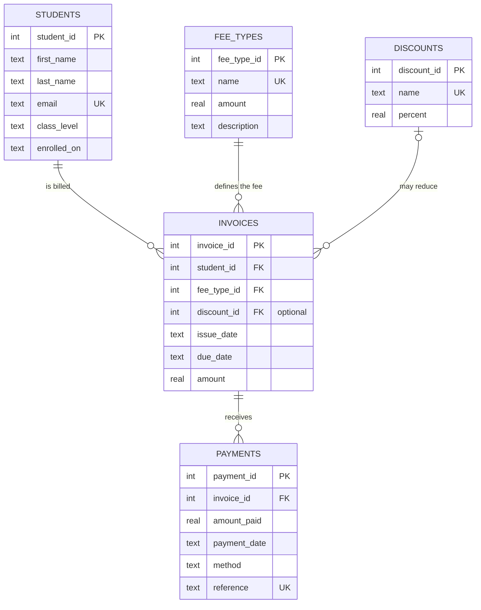

# Entity Relationship Diagram

This diagram is written in Mermaid, which GitHub draws automatically.
(You can also paste the code into https://mermaid.live to export a PNG.)

## How to read it
- One **student** can have many **invoices**. Each invoice belongs to one student.
- One **fee type** (like Tuition) can appear on many invoices.
- An invoice has **zero or one** discount. Many invoices can use the same discount.
- One **invoice** can receive many **payments** (part payments).

## Why this design
- **Normalisation:** each fact is stored once. A student's email lives only in
  `students`; a fee's price lives only in `fee_types`.
- **Part payments:** payments are a separate table, so an invoice can be paid
  in instalments and the outstanding balance is worked out, not typed in.
- **Balances are calculated, not stored.** The `invoice_balances` view adds up
  payments each time, so a balance can never drift out of step with the payments.
- **PK** = primary key, **FK** = foreign key, **UK** = unique key.
